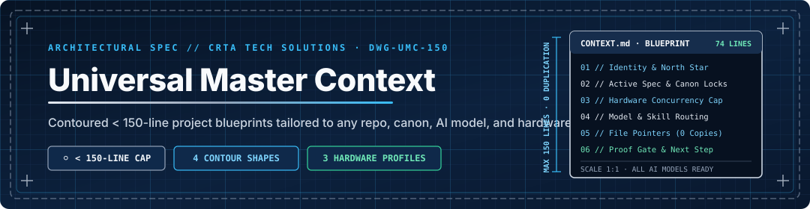

# Universal Master Context

Come in. Everything here has its place, and nothing is missing.

A lightweight generator that writes a contoured CONTEXT.md — under 150 lines — for any project, so an AI agent starts with the right context and nothing extra.

## What's here

- `templates/` — five contours: code, creative canon, business ops, multi-agent, and the CRTA master toolkit.
- `skills/universal-master-context/SKILL.md` — the AI agent skill.
- `preview/index.html` — the live generator.
- `schemas/handoff.json` — the handoff schema.

## Use it

Open https://kelli-dotcom.github.io/universal-master-context/preview/, pick a contour and a hardware tier, and copy your CONTEXT.md.

Details live in `docs/START_HERE.md`. License: see `LICENSE`.
