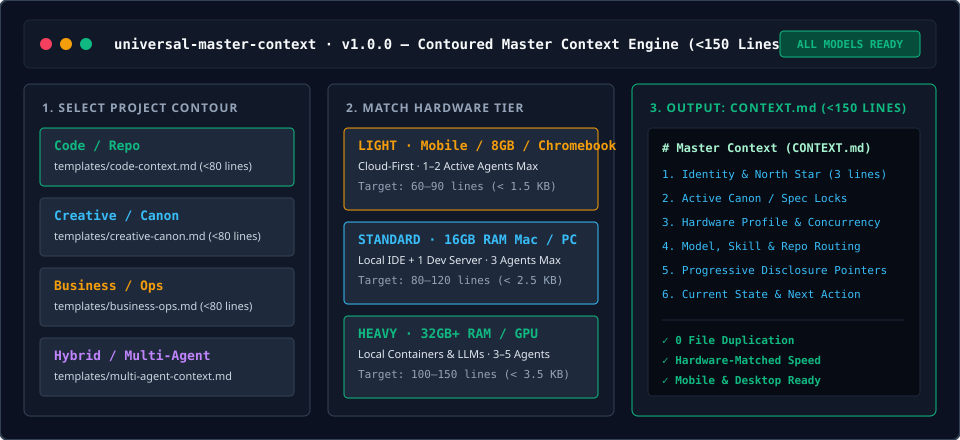

<h1 align="center">Universal Master Context</h1>

<p align="center">
  <strong>Lightweight, adaptive Master Context generator (<code>CONTEXT.md</code> / <code>MASTER_SPEC.md</code> / canon / outline) contoured to any project, AI model, skill, repository, and computer spec.</strong><br />
  <em>Give every AI model and human collaborator full project clarity in under 150 lines—with zero file duplication and hardware-matched speed.</em>
</p>

<p align="center">
  <a href="#-quick-start"><strong>Quick Start</strong></a> ·
  <a href="#-what-why-who-when--how"><strong>Why It Works</strong></a> ·
  <a href="#-repository-directory"><strong>Directory</strong></a> ·
  <a href="skills/universal-master-context/SKILL.md"><strong>AI Skill</strong></a> ·
  <a href="examples/hardware-profiles.md"><strong>Hardware Profiles</strong></a>
</p>

<p align="center">
  
  
  
  
  
</p>

<p align="center">
  
</p>

---

## ✨ What, Why, Who, When & How

- **What It Is:** A zero-bloat framework, reusable AI agent skill ([`skills/universal-master-context/SKILL.md`](skills/universal-master-context/SKILL.md)), and 4 ready-to-copy templates that generate a **60–120 line** (hard cap: **150 lines**) Master Context (`CONTEXT.md`, `MASTER_SPEC.md`, creative canon, or operational outline) tailored to your project and your computer's real hardware specs.
- **Why It Matters:** Bloated 2,000-line prompt files burn tokens, confuse reasoning models, go stale within days, and freeze 8 GB laptops or mobile sessions when agents spawn too many parallel workers. Progressive disclosure + hardware-aware routing keeps every AI session fast, accurate, and in sync.
- **Who It's For:** Software engineers, technical founders, writers & worldbuilders, operations leads, and multi-agent builders working across Claude, Gemini, ChatGPT/Codex, Cursor, Windsurf, Antigravity, Copilot, OpenHands, or local LLMs.
- **When To Use It:** At project kickoff, when unifying multiple repos or agent skills under one source of truth, when onboarding a new AI model in seconds, or when trimming an overgrown spec down to a fast, maintainable contract.
- **How It Works:** Detect the **Project Contour** (`Code / Repo`, `Creative / Canon`, `Business / Ops`, or `Hybrid / Multi-Agent`) and the user's **Hardware Tier** (`Light`, `Standard`, or `Heavy`), route models and skills in a single scannable table, and link to deep files via relative paths instead of duplicating them inline.

---

## 📂 Repository Directory

| File / Path | Purpose | Size Budget |
| :--- | :--- | :---: |
| [`AGENTS.md`](AGENTS.md) | Root progressive disclosure router & hardware concurrency guardrails for all AI models | `< 40 lines` |
| [`llms.txt`](llms.txt) | Universal `< 1.5 KB` AI index for instant single-read model discovery | `< 40 lines` |
| [`skills/universal-master-context/SKILL.md`](skills/universal-master-context/SKILL.md) | Executable 3-step AI agent skill: Contour + Hardware Detection → 6-Part Skeleton → Weight/Speed Validation | `< 95 lines` |
| [`templates/code-context.md`](templates/code-context.md) | Ready-to-copy Master Context starter for web apps, APIs, CLIs, and libraries | `< 80 lines` |
| [`templates/creative-canon.md`](templates/creative-canon.md) | Ready-to-copy Master Context starter for books, worldbuilding, brand systems, and curricula | `< 80 lines` |
| [`templates/business-ops.md`](templates/business-ops.md) | Ready-to-copy Master Context starter for SOPs, field operations, compliance, and launches | `< 80 lines` |
| [`templates/multi-agent-context.md`](templates/multi-agent-context.md) | Ready-to-copy Master Context starter for multi-repo ecosystems and orchestrated agent squads | `< 80 lines` |
| [`examples/hardware-profiles.md`](examples/hardware-profiles.md) | Reference matrix mapping **Light**, **Standard**, and **Heavy** hardware profiles to model tiers, local/cloud execution boundaries, and concurrency caps | `< 60 lines` |
| [`preview/index.html`](preview/index.html) | Zero-dependency interactive HTML live demo for contouring a custom `CONTEXT.md` in the browser | Live Demo |
| [`demo/preview.svg`](demo/preview.svg) | Visual architecture diagram of the 3-step Contour + Hardware + Output pipeline | Visual Proof |
| [`HANDOFF.md`](HANDOFF.md) | Active session state, verification command, blockers, and exact next step | `< 20 lines` |
| [`mistakes.md`](mistakes.md) | Permanent log of context-engineering anti-patterns and "Never Repeat" guardrails | `< 25 lines` |
| [`LICENSE`](LICENSE) | MIT License (CRTA Tech Solutions) | Standard |

---

## 🚀 Quick Start (PC / Laptop & Mobile)

### 💻 1. PC / Laptop Quick Start (Mac, Windows, Linux & Chromebook) — 1-Line `AGENTS.md` Pointer Pattern

Add a single line to any project's root `AGENTS.md` so any AI coding agent loads the skill and templates only when needed—without duplicating files across repositories:

```markdown
- **Master Context & Spec Contouring:** Follow `skills/universal-master-context/SKILL.md` (or load `https://github.com/kelli-dotcom/universal-master-context`) to keep `CONTEXT.md` / `MASTER_SPEC.md` under 150 lines and matched to our hardware tier.
```

Or clone and copy a starter template directly into your project root as `CONTEXT.md`:

```bash
git clone https://github.com/kelli-dotcom/universal-master-context.git
cp universal-master-context/templates/code-context.md ./CONTEXT.md
```

### 📱 2. Mobile Quick Start (iPhone, iPad & Android)

<details>
<summary><strong>📱 Download &amp; Use on Mobile (iOS / Android)</strong></summary>

<br />

1. **1-Tap Direct Download:**  
   👉 **[Download ZIP (Mobile-Friendly)](https://github.com/kelli-dotcom/universal-master-context/archive/refs/heads/main.zip)**

2. **Quick Unzip Steps:**
   - **iPhone / iPad (iOS):** Open the **Files** app → **Downloads** → tap `universal-master-context-main.zip` once to automatically extract the `universal-master-context-main` folder.
   - **Android:** Open **Files by Google** (or **My Files**) → **Downloads** → tap `universal-master-context-main.zip` → tap **Extract**.
   - **Mobile Browser Tip:** If viewing GitHub in Safari or Chrome on mobile without the link above, tap the browser menu (`AA` or `⋮`) → **Request Desktop Website** to reveal GitHub's green **Code → Download ZIP** button.

3. **Use Immediately in Any AI App or Cloud IDE:**
   - **Gemini / Claude / ChatGPT Mobile Apps:** Tap the `+` or attachment icon in chat, attach `skills/universal-master-context/SKILL.md` (plus your chosen file from `templates/`), and prompt: *"Contour a Master Context for my project using this skill and my device specs."*
   - **Reusable AI Workspaces:** Upload `skills/universal-master-context/SKILL.md` and `examples/hardware-profiles.md` once into a **Gemini Gem**, **Claude Project**, or **Custom GPT** so every future chat automatically builds hardware-aware `<150`-line Master Contexts.
   - **Mobile Git & Cloud IDEs:** Open directly on mobile via **Working Copy** (iOS), **GitHub Codespaces**, or **Replit** by importing `https://github.com/kelli-dotcom/universal-master-context`.

</details>

---

## ⚙️ Hardware Tiers at a Glance

| Tier | Typical Hardware | Execution Boundary | Concurrency Cap | Target Context Length |
| :--- | :--- | :--- | :---: | :---: |
| **Light** | Mobile, Chromebook, **8 GB RAM** | Cloud-first, static previews, remote CI | **1–2 agents** | **60–90 lines** |
| **Standard** | **16 GB RAM** Mac / PC | Local IDE + 1 dev server + cloud/light DB | **3 agents** | **80–120 lines** |
| **Heavy** | **32 GB+ RAM** / Workstation GPU | Local containers, vector DB & local LLMs | **3–5 agents** | **100–150 lines** |

---

## 🤝 Contributing

We welcome new `<80`-line project-contour starter templates, hardware profile benchmarks, and progressive-disclosure improvements from both **human builders** and **AI coding agents**:

```bash
# 1. Fork & create a feature branch
git checkout -b feat/your-contour-template

# 2. Verify all templates stay under 80 lines & skills under 150 lines
wc -l AGENTS.md skills/universal-master-context/SKILL.md templates/*.md examples/hardware-profiles.md
```

Read the full guide in **[`CONTRIBUTING.md`](CONTRIBUTING.md)** · **[Open an Issue](https://github.com/kelli-dotcom/universal-master-context/issues)** · **[Submit a Pull Request](https://github.com/kelli-dotcom/universal-master-context/pulls)**

---

## 🌐 CRTA Tech Solutions Open-Source Ecosystem

| Repository | What It Does |
| :--- | :--- |
| **[universal-master-context](https://github.com/kelli-dotcom/universal-master-context)** | Adaptive `<150`-line Master Context generator matched to project contour & computer specs *(this repo)* |
| **Openflex** *(CRTA Proprietary Platform)* | Zero-cost, anti-ghost, Remote-Truth job board (61 verified ATS feeds · 12 Feather Themes) |
| **[stack-blueprints](https://github.com/kelli-dotcom/stack-blueprints)** | 5-tier developer stack matrix (`<5 KB` to Enterprise) & workflow file-creation order CLI + AI skill |
| **[feather-speed](https://github.com/kelli-dotcom/feather-speed)** | Hardware-aware adaptive frontend & backend speed engine (`ECO` / `BALANCED` / `ULTRA`) |
| **[feather-themes](https://github.com/kelli-dotcom/feather-themes)** | 1,092 photobiology-calibrated, zero-dependency WCAG 2.1 AA/AAA themes |
| **[agent-etiquette](https://github.com/kelli-dotcom/agent-etiquette)** | Multi-agent workflow rules, JSON handoff schemas & Rule of 2 loop caps |
| **[archetype-agent-vault](https://github.com/kelli-dotcom/archetype-agent-vault)** | 7 character-driven AI coding agent suites (27 model-agnostic specialists) |
| **[github-trending-kit](https://github.com/kelli-dotcom/github-trending-kit)** | AI agent & skill kit for top-GitHub READMEs, SEO topics & launch conversion |

✨ *Crafted by **CRTA Tech Solutions*** • MIT License • GitHub Topic: `crta-crafted`
